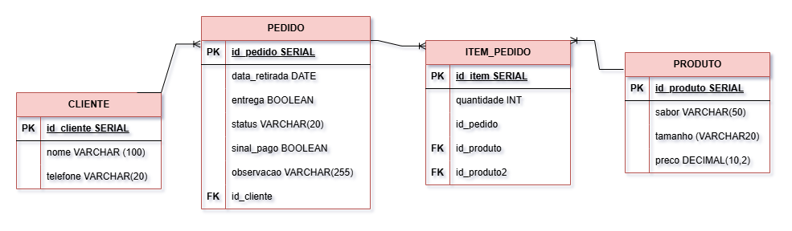

## MER - Bolos da Neide

### Entidades e atributos

#### 🧑 CLIENTE
- id_cliente (PK)
- nome
- telefone

#### 📋 PEDIDO
- id_pedido (PK)
- data_retirada
- entrega
- status
- sinal_pago
- observacao
- id_cliente (FK)

#### 🎂 ITEM_PEDIDO
- id_item (PK)
- quantidade
- id_pedido (FK)
- id_produto (FK)
- id_produto2 (FK)

#### 🍰 PRODUTO
- id_produto (PK)
- sabor
- tamanho
- preco

### Relacionamentos

- 1 CLIENTE faz N PEDIDOS (1:N)
- 1 PEDIDO possui N ITEM_PEDIDO (1:N)
- 1 PRODUTO aparece em N ITEM_PEDIDO (1:N), como 1º ou 2º sabor (id_produto2 é opcional).

### Regras de negócio (RN's)

- O sinal é 50% do valor e deve ser pago antes da produção (REQ09).
- Cancelado após o início da produção: o sinal não é devolvido (REQ11).
- Se entrega = verdadeiro → taxa de R$ 15,00; no balcão, sem taxa (REQ17 e REQ18).

